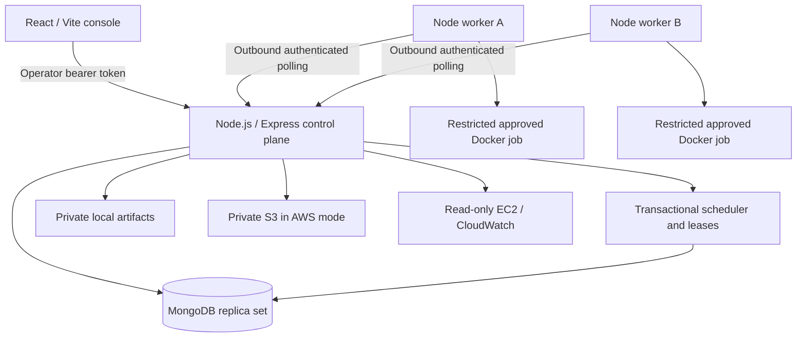

# Architecture

MongoDB stores tasks, workers, attempts, decisions, measurements, events,
settings, experiments and artifact metadata. UUIDs identify records. Compound unique indexes
prevent duplicate worker names/tokens and duplicate attempt numbers.
`Store.connect` initializes collections/indexes idempotently. See the initial
schema in `migrations/001-initial.md`; future incompatible changes require
explicit migrations.

Every mutation of task/attempt/reservation state runs in a snapshot transaction
that first writes one dispatch lock document. Conflicting writers retry the
whole transaction via the MongoDB driver, then recompute reservations. This
serializes the small educational control plane across processes. Reservations
derive from active attempts; transitions cannot decrement counters twice.

Workers claim jobs selected centrally across all eligible workers. Assignments
are leased; abandoned assignments expire. A background backend sweep detects
expired heartbeats/leases even if no worker polls. Execution is at least once.

LOCAL uses two logical workers on one host; it is not evidence of two EC2 hosts.
Host CPU/RAM observations are actual Node `os` readings and may be identical
across local workers. Container process CPU time is a separate job measurement.
The console labels AWS as disconnected in LOCAL mode.

Vite proxies `/api` to Express. Deploy static assets and API behind one HTTPS
origin; do not use Vite as a production server. No broker or inbound worker port
is required.

CSV analysis runs inside the same restricted Docker execution path. The input
fingerprint, explicit cleaning rules and bounded UI metadata accompany private
result ZIPs containing full outputs. Source fingerprints on the job image make
local startup rebuild stale kernels after an update.

Experiment records hold the job IDs, policy, input identity, configuration and
initial worker capacities. Tasks in a batch pin `scheduling_algorithm`; ordinary
tasks continue using global settings. Summaries derive from persisted task/attempt
timestamps and host metrics. Experiment creation and cancellation use the same
transactional dispatch lock as ordinary scheduling. The background maintenance
loop settles terminal batches. See `migrations/002-analytics-experiments.md`.
